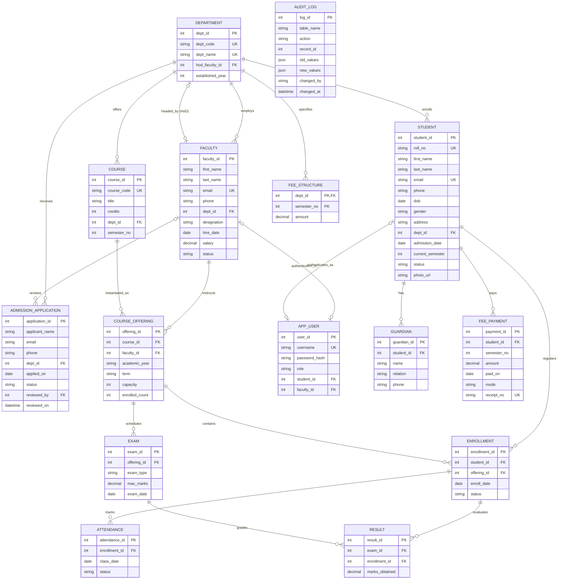

# Entity-Relationship (ER) Design: Student Information Management System (SIMS)

## 1. Conceptual Overview
The Student Information Management System (SIMS) database models the core academic, administrative, and financial lifecycle of a tertiary education institution. The conceptual schema ensures that entities are cleanly separated, functional dependencies are isolated, and referential integrity is strictly maintained.

---

## 2. Mermaid ER Diagram



---

## 3. ASCII Entity-Relationship Diagram

```
+---------------------------------------------------------------------------------------------------+
|                                 SIMS CONCEPTUAL ER DIAGRAM                                       |
+---------------------------------------------------------------------------------------------------+

     [ADMISSION_APPLICATION]
             | (1)
             | reviewed_by (0..1)
             v
         [FACULTY] <----------(0..1) headed_by (0..1)------------+
             |                                                    |
             | (1) employs                                        |
             v                                                    |
      +--------------+ (1) offers     +------------+              |
      |  DEPARTMENT  |--------------> |   COURSE   |              |
      +--------------+                +------------+              |
        |          | (1) specifies          | (1)                 |
        |          v                        v                     |
        |   [FEE_STRUCTURE] (Weak)    [COURSE_OFFERING] <---------+ (instructs)
        |                                   | (1)
        | (1) enrolls                       |
        v                                   | (1) contains
    [STUDENT]                               v
      |   | (1) registers            [ENROLLMENT] (M:N Junction)
      |   +------------------------>        | (1)
      |                                     |
      | (1) has                             +-------------------+
      v                                     | (1) tracks        | (1) evaluated_in
   [GUARDIAN] (Weak)                        v                   v
                                      [ATTENDANCE]           [RESULT]
                                                                ^
                                                                | (1) scores
                                                             [EXAM] <---+ (1) schedules
                                                                        |
                                                             [COURSE_OFFERING]

  [FEE_PAYMENT]        --> Linked to STUDENT (1:N) and verifies against FEE_STRUCTURE
  [APP_USER]           --> Linked 1:1 mutually exclusive to either STUDENT or FACULTY
  [AUDIT_LOG]          --> System-wide autonomous event entity logging data state changes
```

---

## 4. Relationship Explanations, Cardinality, Participation & Weak Entities

### 1. `DEPARTMENT` -- `FACULTY` (employs)
- **Cardinality**: 1:N (One department employs zero or many faculty members; each faculty belongs to exactly one department).
- **Participation**: `DEPARTMENT` is partial (a brand new department may initially have no assigned faculty); `FACULTY` is total/mandatory (every faculty member must be assigned to an existing department).
- **Explanation**: Establishes administrative affiliation and payroll categorization. Deleting a department is restricted if faculty members are still assigned.

### 2. `DEPARTMENT` -- `FACULTY` (headed_by / HoD)
- **Cardinality**: 1:1 (One department has at most one Head of Department; one faculty member can head at most one department).
- **Participation**: Both entities are partial (a department may temporarily have a vacant HoD chair; not all faculty members are HoDs).
- **Explanation**: Models departmental leadership. Stored via `department.hod_faculty_id` with `ON DELETE SET NULL` to ensure that if a faculty member resigns, the department record remains intact with HoD set to NULL.

### 3. `DEPARTMENT` -- `STUDENT` (enrolls)
- **Cardinality**: 1:N (One department enrolls zero or many students; each student belongs to exactly one major department).
- **Participation**: `DEPARTMENT` is partial; `STUDENT` is total (a student must belong to a degree-granting academic department).
- **Explanation**: Establishes the academic program for curriculum tracking, cohort statistics, and departmental fee liability.

### 4. `STUDENT` -- `GUARDIAN` (has)
- **Cardinality**: 1:N (One student may have one or more emergency contacts/guardians; each guardian entry is tied to a specific student).
- **Participation**: `STUDENT` is partial (zero or more guardians recorded); `GUARDIAN` is total (a guardian record cannot exist without an associated student).
- **Weak Entity Status**: `GUARDIAN` is an **existence-dependent weak entity** conceptually, as guardian records have no independent existence outside the student. Deletion of a student cascades (`ON DELETE CASCADE`) to all their guardian records.

### 5. `DEPARTMENT` -- `COURSE` (offers)
- **Cardinality**: 1:N (One department designs and offers many catalog courses; each course is owned by one department).
- **Participation**: `DEPARTMENT` is partial; `COURSE` is total.
- **Explanation**: Defines syllabus governance. A department cannot be deleted if active catalog courses remain under its code.

### 6. `COURSE` -- `COURSE_OFFERING` (instantiated_as)
- **Cardinality**: 1:N (One syllabus course may be offered across multiple academic terms/years; each offering is an instance of one course).
- **Participation**: `COURSE` is partial (catalog courses may be dormant); `COURSE_OFFERING` is total.
- **Explanation**: Separates abstract curriculum definition from physical semester scheduling (term, academic year, classroom seat capacity, instructor assignment).

### 7. `FACULTY` -- `COURSE_OFFERING` (instructs)
- **Cardinality**: 1:N (One faculty member may teach zero or multiple offerings; each course offering is assigned to a primary faculty instructor).
- **Participation**: `FACULTY` is partial; `COURSE_OFFERING` is total.
- **Explanation**: Allocates teaching workload and determines grading authorization.

### 8. `STUDENT` -- `COURSE_OFFERING` through `ENROLLMENT` (registers)
- **Cardinality**: M:N resolved via associative junction entity `ENROLLMENT`.
- **Participation**: `STUDENT` is partial (new students in orientation may not yet have registered); `COURSE_OFFERING` is partial (an elective offering may have 0 enrollments initially).
- **Explanation**: Captures student course registration per semester. A composite unique constraint `UNIQUE(student_id, offering_id)` strictly forbids double-enrollment in the same offering.

### 9. `ENROLLMENT` -- `ATTENDANCE` (tracks)
- **Cardinality**: 1:N (One student enrollment record accumulates multiple daily attendance logs; each attendance entry belongs to one enrollment).
- **Participation**: `ENROLLMENT` is partial; `ATTENDANCE` is total.
- **Explanation**: Granular day-by-day attendance tracking. Deleting or dropping an enrollment cascade-removes or flags attendance logs, and a business trigger prevents attendance marking if enrollment is 'Dropped'.

### 10. `COURSE_OFFERING` -- `EXAM` (schedules)
- **Cardinality**: 1:N (One offering conducts multiple evaluations e.g. Internal, Midterm, Final; an exam belongs to exactly one offering).
- **Participation**: `COURSE_OFFERING` is partial; `EXAM` is total.
- **Explanation**: Defines assessment milestones, exam dates, and maximum marks thresholds for that offering.

### 11. `EXAM` & `ENROLLMENT` -- `RESULT` (evaluates)
- **Cardinality**: Ternary relationship decomposed into binary: `RESULT` connects one `EXAM` and one `ENROLLMENT` (1:N from each).
- **Participation**: `EXAM` is partial; `ENROLLMENT` is partial; `RESULT` is total.
- **Explanation**: Captures actual marks awarded. A candidate key `UNIQUE(exam_id, enrollment_id)` ensures that a student receives at most one grade record per scheduled examination.

### 12. `DEPARTMENT` -- `FEE_STRUCTURE` (specifies)
- **Cardinality**: 1:N (One department defines tuition fee schedules across 8 semesters).
- **Participation**: `DEPARTMENT` is partial; `FEE_STRUCTURE` is total.
- **Weak Entity Status**: `FEE_STRUCTURE` is an **identifying weak entity** whose composite primary key is `(dept_id, semester_no)`. It relies on the parent `DEPARTMENT` for identity.

### 13. `STUDENT` -- `FEE_PAYMENT` (pays)
- **Cardinality**: 1:N (One student makes zero or multiple installment fee payments over their degree).
- **Participation**: `STUDENT` is partial; `FEE_PAYMENT` is total.
- **Explanation**: Financial ledger tracking. Each payment references a semester number and issues a unique receipt number (`receipt_no UNIQUE`).

### 14. `ADMISSION_APPLICATION` -- `DEPARTMENT` & `FACULTY` (submits & reviews)
- **Cardinality**: 1:N with `DEPARTMENT`, 0..1:N with `FACULTY`.
- **Participation**: `ADMISSION_APPLICATION` is total on `DEPARTMENT`, partial on `FACULTY` (until reviewed).
- **Explanation**: Captures applicant pipeline prior to official student matriculation. The stored procedure `sp_approve_admission` transitions an approved application into an official `STUDENT` row.

### 15. `APP_USER` -- `STUDENT` / `FACULTY` (authenticates_as)
- **Cardinality**: 1:1 optional on both sides.
- **Participation**: Partial on all sides.
- **Explanation**: Authentication credential store. A database `CHECK` constraint guarantees mutual exclusivity: an `app_user` with role `'student'` has `student_id IS NOT NULL AND faculty_id IS NULL`; role `'faculty'` has `faculty_id IS NOT NULL AND student_id IS NULL`; role `'admin'` has both foreign keys `NULL`.
